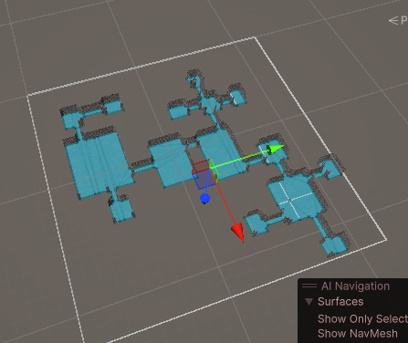
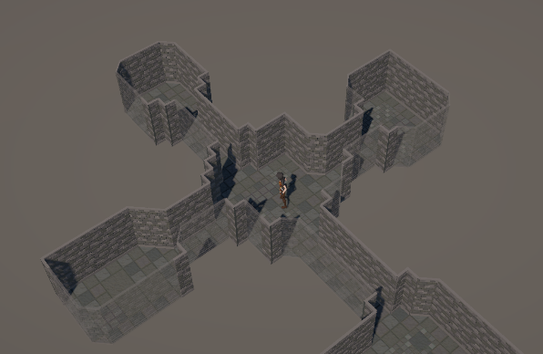

# Procedural-Project

**Procedural Level Generation | Unity 6 | C#**

## Overview

An educational Unity project developed while studying procedural level generation through GameDev.tv training.

The project explores the generation of dungeon layouts, room connections, environment geometry, decoration systems, and navigation.

## Screenshots

### Procedural dungeon layout

### Another generated map

### Generated environment

### Player in the dungeon

## Technical Features

- **Procedural Room Generation:** Creates dungeon layouts using configurable room templates and corridors.
- **Seed-Based Generation:** Supports generating layouts using randomized seeds.
- **Room Classification:** Assigns special room types, including starting rooms, exits, treasure rooms, and boss rooms.
- **Marching Squares:** Converts texture-based level representations into tile-based geometry.
- **Environment Decoration:** Includes rule-based systems for placing environmental objects.
- **AI Navigation:** Integrates Unity NavMesh for navigation and agent movement.
- **Configurable Level Parameters:** Uses ScriptableObjects to configure generation settings.

## Technologies

- Unity 6 (6000.0.59f2)
- C#
- Unity AI Navigation
- Unity Input System

## Project Structure

- `Assets/Scripts/` — Core level generation and gameplay scripts
- `Assets/Scripts/LevelDecorator/` — Environment decoration rules
- `Assets/Scripts/Utilities/` — Supporting utilities
- `Assets/Scenes/` — Unity scenes
- `Packages/` — Project dependencies
- `ProjectSettings/` — Unity configuration

## Development Context

This repository was created as part of a GameDev.tv educational course. It is preserved as a demonstration of technical learning and practical experience with Unity and procedural generation.

Course-guided work and any independently developed modifications should be distinguished when documenting project contributions.

## Project Status

Educational project. The project was run and manually checked in the Unity Editor by the repository owner in October 2026. The owner reported that procedural maps continued to generate and that the player could navigate across the entire generated map, including rooms and corridors.

A navigation issue was diagnosed using `NavMeshPathStatus` results (`PathComplete`, `PathPartial`, and `PathInvalid`), `NavMesh.SamplePosition`, and the Scene view NavMesh visualization. Switching the `NavMeshSurface` geometry source to **Physics Colliders** and disabling the auxiliary **Level Layout** GameObject yielded working room-to-corridor navigation in the tested configuration. These are owner-reported manual results, not automated test coverage or independent verification.

## Testing Opportunities

Potential test scenarios include:

- Generated rooms remaining inside configured map boundaries
- Room and corridor connectivity
- Seed reproducibility
- Correct assignment of special room types
- Valid initial player placement
- NavMesh generation following layout construction
- Handling of invalid or extreme generation parameters

These are proposed test scenarios, not claims that automated tests have already been implemented.

## Credits and Acknowledgments

This project was developed as part of a GameDev.tv training course, using educational materials and source code provided by the instructors.

The instructors authorized students to reuse the course code in their own projects.

The repository is maintained as part of my educational and technical portfolio, demonstrating practical experience with Unity, C#, and procedural level generation.
